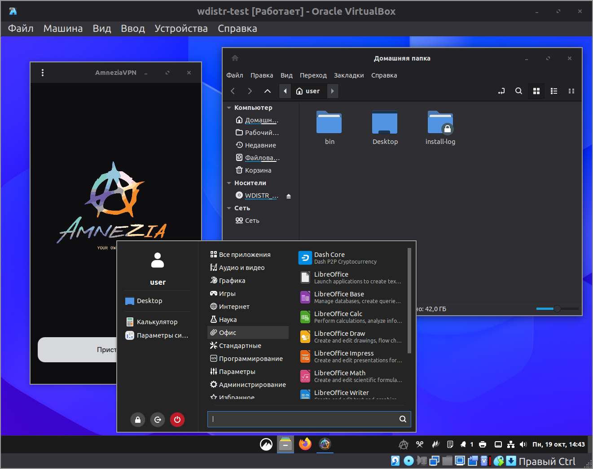
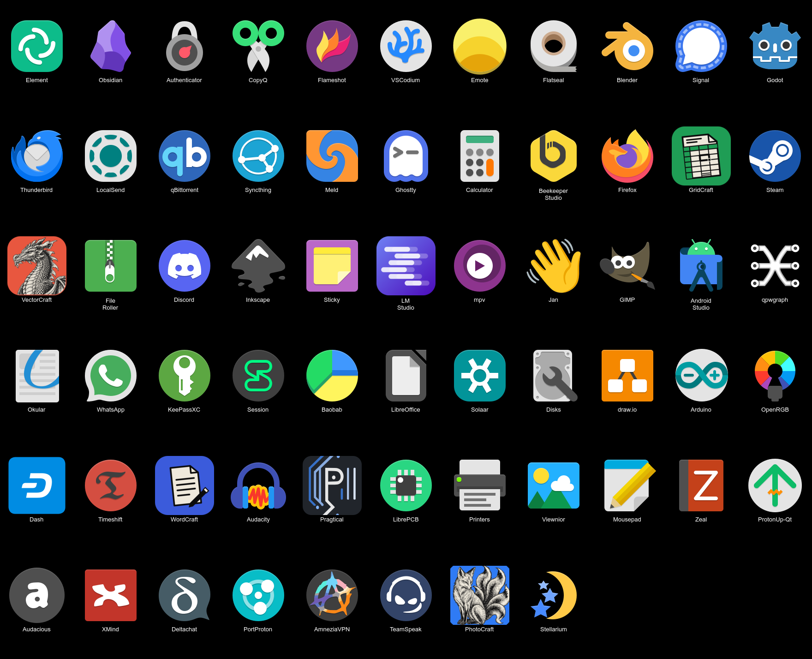

# wdistr

Свой дистрибутив на базе Arch Linux: переупаковка стока и докрутка под
философию «поставил и работает» — минимум настройки, минимум вопросов при
установке, оболочка fish. Своего репозитория пакетов нет: база —
стандартный Arch, всё доведённое живёт в профиле ISO и конфиге
установщика.





Отдельная цель — не заваливать пользователя ненужными вопросами. Там, где
разумный ответ можно предопределить, он преднастроен: установка — две
команды, настройки десктопа приезжают готовыми, программы ставятся сами
в фоне. Если система спрашивает — значит, спрашивать было не о чем, и
такой вопрос убирается, а не оставляется «для гибкости». Пример: emote
при каждом входе показывал приветственное окно — окно убрано, а не
предложено пользователю разбираться с ним.

Что в составе сейчас: рабочий стол — Cinnamon, файловая система —
btrfs с мгновенными снапшотами (timeshift: снимок и откат состояния —
дело минут). Полный список программ (что запечено в ISO, что
доустанавливается при первом запуске) — в карточке
`Cards/Базовый набор программ.md`. Шифрования дисков нет — если оно очень нужно, клонируйте
репозиторий и доделайте: всё для сборки лежит здесь. Свой рабочий стол
планируется в следующей версии.

## Скачать

Готовые сборки — на странице релизов:
<https://github.com/sergDash/wdistr/releases>

Под каждой версией — sha256 образа и дата сборки. После скачивания
сверьте хеш: `sha256sum <файл.iso>`.

Образ пересобирается примерно раз в месяц под свежий Arch Linux
(решение 2026-10-18): пакетная база Arch течёт, и в новый ISO
входят накопленные обновления стока вместе с нашими правками.

Готовый ISO записывается на флешку и запускается в железной машине.
Диск для установки — минимум 85 ГиБ: на 75 ГиБ установка проходит, но
первый запуск упирается в место (своп 8 ГиБ + кэши сборок AUR-пакетов,
опыт 2026-10-17). Если планируется
работа в Android Studio (входит в первый запуск), рекомендуется диск
100+ ГиБ: сама студия занимает ~4 ГБ, а Android SDK с эмулятором — ещё
10–20 ГБ по мере разработки.

Место на диске (по итогам тестовой установки 2026-10-13, диск 64 ГиБ,
цифры без Android Studio — она добавлена в состав 2026-10-14, итоги
следующего испытания дадут цифры около +5 ГБ): система с доустановкой
программ заняла ~38 ГиБ, свободными остались
~24 ГиБ. Кэши установки (пакеты pacman и сборки yay, ~12 ГиБ) после
успешной инициализации чистятся автоматически.

В живой среде — две команды:

```sh
disks                                  # список дисков: какой диск есть и чем занят
setup ivan 12345 /dev/sda              # всё установит (имя, пароль, диск)
```

Перезагрузка — система работает. Идет доустановка программ в фоне.
После успешного завершения на рабочем столе появляется
Установка-завершена.txt. Если файл не появился или что-то пошло не так —
результаты установки лучше спросить у opencode: он точно скажет по логу
(`~/install-log/first-boot.log`), что успешно, а что упало.

Самопроверка установки — в консоли перейти в папку с логами и
запустить там opencode:

```sh
cd ~/install-log
opencode
```

и попросить агента: «проверь установку». Рядом с логом лежит
AGENTS.md с чек-листом — агент сам пройдёт по нему: лог первого
запуска, маркер, таймеры обновления, состав пакетов, зеркала — и
скажет, что в порядке, а что нет.

Установочный диск уже содержит ИИ-агента opencode и инструкцию для
него — так что поговорить с ИИ можно и с установочного диска, до
установки. Раскладка на русскую переключается однократным нажатием
Shift.

## Зачем

За проектом стоит очень много работы: множество пусков, испытаний и
шлифовок — и они продолжаются. Именно поэтому он имеет смысл как свой
дистрибутив: каждая мелочь пройдена по кругу «собрал — испытал —
поправил», а не описана по памяти.

Может показаться, что проще помучиться один раз при установке стока и
настроить всё самостоятельно — но количество нюансов велико: таймеры
обновлений, работающие зеркала, тёмные темы для всех приложений, консоль
с кириллицей, раскладки клавиатуры, serial-доступ к платам, шрифты,
снапшоты. Дистрибутив делает за несколько часов в автоматическом режиме
то, на что при самостоятельной настройке ушли бы недели.

## Автообновление

Система обновляется сама — три таймера по понедельникам в 00:00:

- `wdistr-sys-update` — `pacman -Syu` (система и пакеты Arch);
- `wdistr-aur-update` — `yay -Sua` (AUR-пакеты);
- `wdistr-flatpak-update` — `flatpak update`.

Перед обновлением Timeshift ставит снапшот-эталон — если после
обновления что-то сломается, откат в пару кликов. Обновления идут
под общей блокировкой, конфликтов между ними нет.

**Снапшоты по умолчанию выключены** — чтобы не забивать диск.
Включаются один раз: открыть `timeshift-gtk`, поставить галочки
расписания и сохранить. Без этой настройки таймер проверки работает,
но снапшоты не создаёт — это ожидаемо, а не поломка. Конфиг
машинозависим (в нём UUID диска), поэтому в дистрибутив он не
поставляется.

Если компьютер в момент расписания выключен — при следующем включении
пропущенное окно догоняется автоматически (`Persistent=true` в
таймерах): обновление запустится сразу после загрузки. Пропусков
накоплением не бывает — каждый таймер либо отработал, либо отработает
при ближайшем включении.

Лог каждого обновления — в `~/install-log/` (`sys-update.log`,
`aur-update.log`, `flatpak-update.log`). Управляются таймерами
`systemctl list-timers wdistr-*`, остановить —
`sudo systemctl disable --now <имя-таймера>`.

---

Всё для сборки — в этом репозитории: профиль ISO (`iso/`), конфиг
установщика и доставка настроек (`install/`), скрипты виртуальных машин
(`vm/`), перенос настроек с хоста (`settings/`). Знания — в `Cards/`
(рабочие карточки, на них ссылается книга) и `handbook/` (книга о
проекте, пока черновики). Работа ведётся через агента (opencode):
пользователь принимает решения, агент выполняет работу.

## Инструкция

Сказать агенту — «давай пройдёмся по проекту и соберём свой дистрибутив».
Агент первым делом определяет, под какой системой идёт работа, и
выбирает, где собирать: на этой машине или на выделенной сборочной
виртуальной машине. По выбору читается одна карточка, а не обе сразу:

- **Машина уже работает под нашим дистрибутивом (Arch)** — сборка прямо
  на ней: доустановить пакеты и запустить mkarchiso, выделенная VM не
  нужна. Действующая схема: `Cards/Сборочная реальная машина.md`.
- **Машина без Arch** (прежняя схема, действовала до 2026-10-12) —
  выделенная сборочная VM: `Cards/Сборочная виртуальная машина.md`.
  Карточка покрывает весь путь: создание VM → установка Arch в её окне →
  подготовка к работе → сборка.

Сам конвейер (состав профиля, ловушки mkarchiso, тест собранного ISO) —
в `Cards/Сборка ISO archiso.md`; принятые решения проекта — в
`AGENTS.md`.

> **Сноска.** Глюк VirtualBox: собранная целевая машина при первом входе
> в систему может не отрисовать курсор — просто потяните окно, и
> указатель появится. После правильно настроенной службы
> (`vboxservice`, решение 2026-10-17) глюк, по-видимому, прошёл; старую
> запись оставляем как запасной вариант на всякий случай.

> **Сноска.** Для VirtualBox в состав добавлен второй терминал —
> `xfce4-terminal`. Гостевые драйверы VirtualBox глючат с ускоряемыми
> приложениями, и Ghostty (по умолчанию) там может не отрисоваться —
> тогда открывайте `xfce4-terminal`. Терминал по умолчанию — Ghostty
> с `--gtk-single-instance=false`, чтобы «Открыть в терминале» из Nemo
> открывалось в текущей папке.
